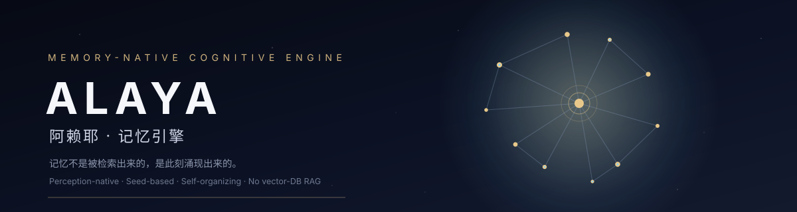
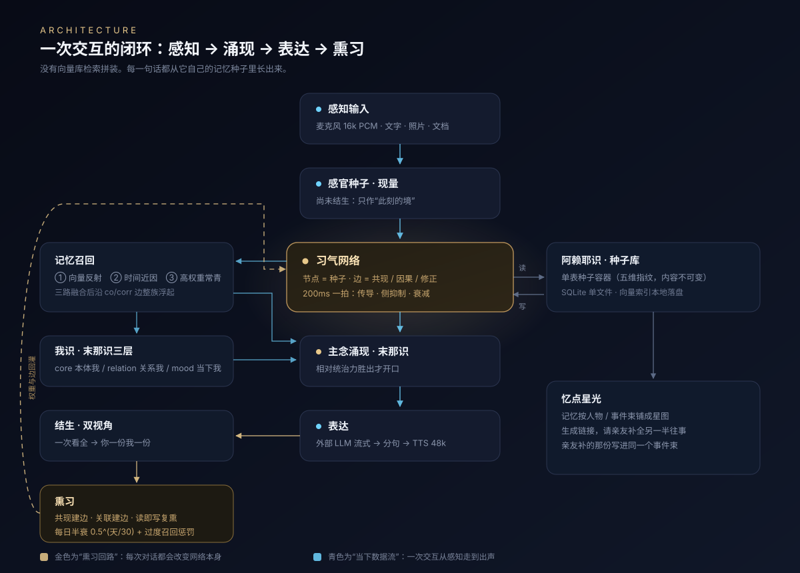

<p align="center">
  
</p>

<p align="center">
  <a href="LICENSE"></a>
  
  
  
  
  
</p>

<p align="center"><b>English</b> · <a href="README.zh-CN.md">中文</a></p>

<h3 align="center">Memory is not retrieved. It emerges.</h3>

Most "AI memory" today is a vector index. Ask again tomorrow and it returns the same top-k chunks —
or confidently recalls something you never said, because nothing in that index ever gets *revised*.

Alaya replaces the index with a small **habit network of memory seeds**. Seeds compete for activation every 200 ms.
Only the winning thought gets spoken. Unused memories decay. Wrong ones get superseded — and the record of
*"it used to believe that"* stays. Every conversation slightly rewires the network.

It is not a chat product. It is the memory substrate underneath one.

> **Live demo (中文)** → <https://dev.nice-ai.cn/alaya/>
> Author-hosted, real instance running real models. Heads-up for non-Chinese visitors:
> login requires a **Chinese mobile number + SMS code**, so most people outside mainland China cannot get in.
> Everything you type *is* written into its memory — **please don't enter anything private**.
> The demo may go away at any time; for real use, run it locally (takes one command, see below).

---

## What is actually different

| | Typical RAG stack | Alaya |
|---|---|---|
| Unit of memory | document chunk + embedding | **seed**: one fact, with time / person / emotion / scene fingerprints |
| Recall | cosine top-k, then stuff into prompt | three-way fusion (vector / recency / evergreen), then **competition** in the habit network |
| Who decides to speak | the caller — every turn must answer | the network — only a dominant thought crosses the threshold |
| Writing | embed once, never changes | **present window → consolidation**: utterances live briefly, then get re-read as a whole and distilled into long-term seeds |
| Revision | overwrite or append | new seed + `corr` edge + old seed marked `superseded`; content is immutable |
| Forgetting | none | daily half-life decay + over-recall penalty |
| Ownership | one global store | **one Ālaya per AI persona** (dual-perspective, first person on both sides) |

The practical difference: ask it about the same event after 50 mentions and the memory does not get louder —
recall reinforcement saturates. Tell it "no, that's not what happened" and the old seed is superseded instead of
quietly living next to the new one.

---

## Architecture

<p align="center">
  
</p>

| Stage | File | What it does |
|---|---|---|
| Perceive | `index.py` `_sense_from_audio/_sense_from_text` | 16 kHz PCM / text / image → sensory seed |
| Habit network | `manas.py` `step/tick` | 200 ms beat: spread, lateral inhibition, decay, threshold layering |
| Emergence | `manas.py` `conceive` | the dominant cluster is condensed into "this thought" (vedanā / saṃjñā / cetanā) |
| Recall | `retrieval.py` `recall` | vector + recency + evergreen, fused, then expanded along `co/corr` edges |
| Self-model | `selfmodel.py` | core / relation / mood — three layers, stored separately |
| Express | `llm.py` + `_run_turn` | external LLM stream → sentence split → TTS stream, 48 kHz PCM out |
| Consolidate | `dualview.py` | one dialogue read as a whole → neutral facts → two first-person seeds |
| Perfume | `xixi.py` | co-occurrence edges, association edges, read-to-write reinforcement, daily decay |

---

## The loop, in six ideas

**1. Seeds, not chunks.** One fact per row, five-dimension fingerprint, plus evidence and provenance.

```sql
alaya_seeds(
  seed_type, seed_text, raw_text,        -- semantics (immutable)
  owner_ai_id, peer_ai_id, subject,      -- whose memory, about whom
  seed_date, time_fuzzy,                 -- relative dates are resolved at write time
  person_id, scene, life_stage,          -- person / scene / life phase
  emotion_tone_id, emotion_word,         -- emotion
  confidence, weight, recall_count,      -- the only fields perfuming may touch
  state, superseded_by, episode_id,      -- revision chain + event bundle
  expire_at                              -- lifetime of a transient memory
)
```

**2. Present window → consolidation.** What you just said is *not* memory yet. It sits in a short-lived window
(`state=temp`, excluded from the network, excluded from vector search, 30 min TTL), and only after the segment
goes quiet does it get read as a whole and distilled into long-term seeds.

Why: extracting turn-by-turn sees one turn at a time. Tell the same story three times and you get three
strangers that never recognise each other. Reading the segment as a whole is what makes
"one event → one complete fact" actually hold.

**3. Dual-perspective consolidation.** From one neutral fact, two seeds are derived deterministically:
the user's persona gets it in the first person, the AI persona gets it in the first person, with opposite
ownership. Two seeds — never the same text copied twice.

**4. Perfuming (熏习): five operators, weights only.**

| Operator | Trigger | Effect |
|---|---|---|
| `strengthen_cooccurrence` | seeds written in the same turn | pairwise edge 0.3, +0.02 when it already exists (cap 1.0) |
| `associate_seeds` | a new seed enters | edges to semantic neighbours (≥0.55, top 5) + shared reinforcement |
| `reinforce_on_recall` | seed recalled | `0.1 × relevance / (1 + recall_count/4)` — first recall is vivid, the 50th barely adds |
| `decay_half_life` | daily 04:00 | `weight = 0.5^(days_since_recall/30) / (1 + recall_count/30)` |
| `supersede` | user corrects it | old seed ×0.5 weight, marked `superseded`, chain preserved |

`skill` seeds (conversational basics like "ask one question at a time") are **exempt from decay** — a general
ability should not fade because it went unused.

**5. No absolute threshold — dominance is relative.**

There is no `if intensity > 0.7` anywhere. A thought earns the right to be spoken by being **42% ahead of
the runner-up** in the network, not by crossing a fixed number:

```
dominance = (act[lead] - act[second]) / act[lead]
dominance ≥ 0.42  → speak          (DOM_MANIFEST)
dominance ≥ 0.18  → conscious      (thought has formed, hasn't taken over)
```

Why relative: different personas have completely different activation ranges — one is talkative, one is terse;
the same persona differs between midnight and noon. An absolute gate would either make one persona mute or
make another interrupt constantly. Relative dominance is scale-free, so the same two numbers hold for all of them.

**6. Star map: memory can be completed by someone else.** Seeds are laid out by person / event bundle.
You can send a link to the other person in the story: *"you're in this memory — want to fill in the half I don't have?"*
Their contribution is written into the **same event bundle**, not a separate store. That star lights up.

---

## Quick start

```bash
git clone https://github.com/imcosy/alaya_v2.git
cd alaya_v2
./run.sh
```

`run.sh` creates a venv, copies `config.example.json` → `config.json`, and creates `data/alaya.db`.
Open `http://127.0.0.1:9890/` and register a local account (no SMS, no OAuth).

It starts fine without any API key — voice and replies simply won't work until you fill them in.

### One key, one endpoint

Everything the engine needs — chat, vision, speech recognition, speech synthesis, embeddings — is served by a
single OpenAI-compatible gateway behind **one key**:

1. Open **https://dev.nice-ai.cn/open/** and sign in with a phone number.
2. Create a key (`sk-s2s-...`).
3. Paste it into the UI (user icon → profile → ⚙️ model settings) or `config.json`.

| Capability | Endpoint |
|---|---|
| Chat / vision | `POST {base}/chat/completions` |
| ASR | `POST {base}/audio/transcriptions` |
| TTS | `POST {base}/audio/speech` (48 kHz PCM out) |
| Embeddings | `POST {base}/embeddings` |

Each key comes with a free quota; usage and remaining balance are shown on that page. Voice aliases
(`zh-female-1` …) are provided by the gateway and can be assigned per persona.

The project deliberately ships **no per-vendor settings**. If you want to run against your own stack
(vLLM / Ollama / Xinference / any OpenAI-compatible server), point `server/llm.py` at it — that's the only
place that talks to a model.

Switching the embedding model is detected automatically: old vectors are discarded and rebuilt from seed text.

---

## Configuration

Two equivalent ways, both effective immediately (no restart):

1. **In the UI**: user icon → profile → ⚙️ model settings
2. **`config.json`** (template: [`config.example.json`](config.example.json))

```json
{
  "server": { "host": "0.0.0.0", "port": 9890, "default_ai_name": "如意" },
  "gateway": { "base_url": "https://dev.nice-ai.cn/open/v1", "api_key": "sk-s2s-..." }
}
```

Environment variables win over the file:

```bash
ALAYA_PORT=9890
ALAYA_GATEWAY_BASE=https://dev.nice-ai.cn/open/v1
ALAYA_GATEWAY_KEY=sk-s2s-...
```

**Voices** are gateway voice aliases (no built-in cloning) — pick one per persona in the profile panel.
**Speaker identification** is single-user in the open edition: the person at the microphone is the logged-in
account.

---

## Some real numbers

Default values in the code, not marketing copy:

| Item | Value | Where |
|---|---|---|
| Habit network beat | 200 ms | `manas.py` |
| Recall vector threshold | 0.42 | `retrieval.py` |
| Association edge threshold | 0.55 (top 5) | `xixi.py` |
| "Same event" / "related" | 0.88 / 0.72 | `retrieval.py` |
| Half-life | 30 days | `xixi.py` |
| Recall saturation | `1/(1+recall/4)` | `xixi.py` |
| Consolidation trigger | 90 s idle / 40 items / 3 high-arousal | `working.py` |
| Transient memory TTL | 30 min | `working.py` |
| TTS output | 48 kHz · int16 · mono | `llm.py` |
| Seed table | 1 table, 27 columns | `schema.sql` |

---

## API

| Method | Path | Purpose |
|---|---|---|
| POST | `/api/auth/register` `/login` `/logout` | local accounts |
| GET | `/api/me` | current user |
| GET/POST | `/api/config` | read / write model settings (keys masked) |
| GET | `/api/ais` | personas you can talk to |
| **WS** | `/ws` | `init / start / stop / chat / material / interrupt / voice / manas` |
| POST | `/api/chat` | synchronous text turn (for testing) |
| POST | `/api/import` | text / file / photo → memory seeds |
| GET | `/api/seeds` | seed store |
| GET | `/api/working` | present window (not yet consolidated) |
| GET | `/api/selfmodel` | the three self-model layers |
| GET | `/api/network` | habit network (concepts, edges, type stats) |
| GET/POST | `/api/amnesia/*` | star map: galaxy / invites / forward / add |

WebSocket binary frames are **48 kHz / int16 / mono PCM**, played directly with `AudioContext({sampleRate: 48000})`.

---

## Design notes, trade-offs, known limitations

Honest list — these are choices, not oversights:

- **ASR is whole-utterance, not streaming.** Most OpenAI-compatible vendors only expose file upload. TTS is still
  streamed sentence by sentence, so time-to-first-audio stays low. A streaming ASR adapter is a natural PR.
- **SQLite is the store.** WAL + one writer + per-thread connections. Great for a personal instance or a small
  server; not a multi-tenant cluster.
- **The habit network is in-memory per persona.** Ticks are O(nodes × edges). Tens of thousands of seeds per
  persona are fine; millions are not, and would need sharding.
- **Speaker identification is single-user.** The open edition treats the person at the microphone as the logged-in account; voiceprint matching would need a separate service.
- **Auth is deliberately minimal.** Local accounts, PBKDF2, bearer tokens. No OAuth, no roles, no email
  verification. If you expose it publicly, put it behind a reverse proxy with its own auth.
- **Text is the internal medium for extraction; sound is not.** Audio goes to ASR, seeds are text + embeddings.
  A fully pre-linguistic path (raw audio tokens as memory) is explored in a separate v3 prototype, not here.
- **No built-in evaluation suite.** The numbers above are measured thresholds from real usage, not benchmark scores.

---

## Repository layout

```
alaya_v2/
├─ run.sh                  one-shot launcher
├─ config.example.json     config template
├─ server/
│  ├─ index.py             FastAPI app (REST + WS + static)
│  ├─ settings.py          config center (file + env)
│  ├─ db.py                SQLite base (the only dialect translation layer)
│  ├─ schema.sql           all tables
│  ├─ llm.py               external LLM / ASR / TTS / embeddings / vision
│  ├─ auth.py              local accounts (PBKDF2 + tokens)
│  ├─ manas.py             habit network / dominant-thought emergence
│  ├─ retrieval.py         three-way recall + vector index
│  ├─ seeds.py             seed container
│  ├─ xixi.py              perfuming operators
│  ├─ selfmodel.py         three self-model layers
│  ├─ dualview.py          dual-perspective extraction
│  ├─ extract.py           fingerprint extraction
│  ├─ working.py           present window + consolidation
│  ├─ organize.py          concept-layer condensation
│  ├─ guide.py             public persona's style formation
│  ├─ profile.py           voices / self-portraits
│  └─ amnesia.py           star map
├─ public/                 console + star map + browser recording
├─ assets/                 banner & architecture (SVG)
└─ data/                   runtime: alaya.db / vectors.npz / faces/
```

---

## FAQ

**Why not just use a vector database?**
Because "what comes to mind" and "what to say" are different problems. A vector DB answers the first one, once.
Alaya needs memories that excite and inhibit each other, and that change weight through use — that's dynamics
on a graph, not top-k.

**Can I run it fully locally?**
Yes. `server/llm.py` is the only file that talks to a model — point it at vLLM / Ollama / Xinference / any
OpenAI-compatible server and set `gateway.base_url`. Nothing in the engine requires a specific vendor.

**Where is my data?**
`data/alaya.db`, one file, on your machine. But your conversation text **is sent to whichever providers you
configure** — judge that for yourself.

**Can I change the embedding model?**
Yes. Dimension changes are detected; old vectors are dropped and rebuilt from seed text automatically.
Manual rebuild: stop, delete `data/vectors.npz`, start.

**How is this different from "AI companion" projects?**
It doesn't ship a persona or a frontend. It ships the thing underneath: a memory that belongs to one AI and
changes over time. The console is just an observation window.

---

## License

[Apache-2.0](LICENSE). Issues and PRs welcome.

<p align="center">
  <sub>ALAYA · 阿赖耶 — 一切种子如瀑流</sub>
</p>
